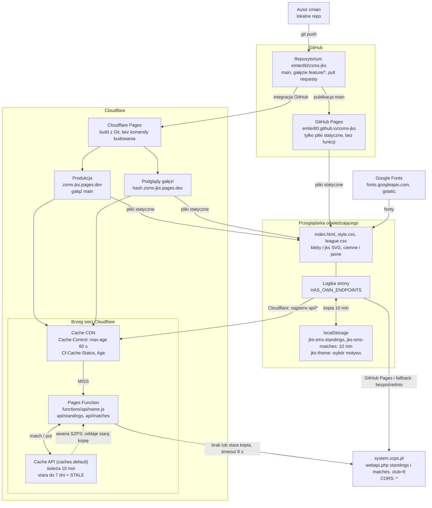
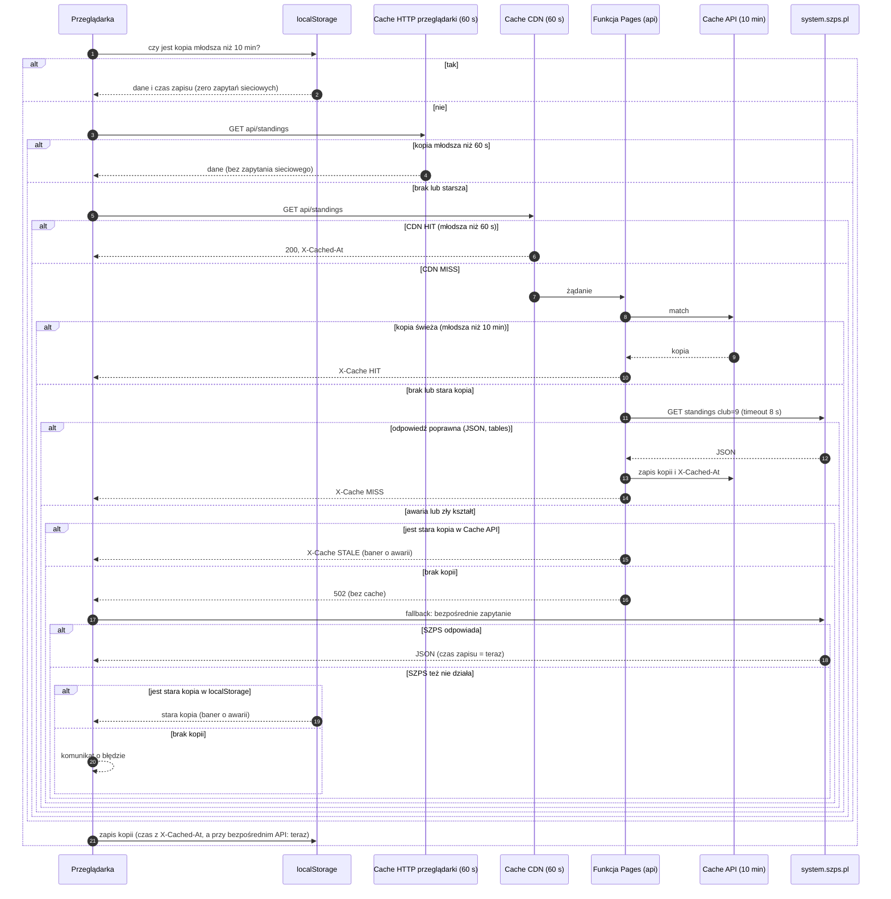

# Architektura strony JKS SMS Jastrzębie

Strona statyczna (HTML, CSS, czysty JavaScript, bez budowania) z tabelami ligowymi i wynikami
meczów. Dane pobiera na żywo z API systemu SZPS. Jest publikowana równolegle na GitHub Pages i na
Cloudflare Pages.

> **Stan wdrożenia.** Cache po stronie serwera (Cloudflare Pages Function) został scalony do `main`
> w pull requeście [#1](https://github.com/emter80/zsms-jks/pull/1). Działa na Cloudflare; na GitHub
> Pages funkcji nie ma, więc tam strona pyta API SZPS bezpośrednio i polega na cache w przeglądarce.

## 1. Architektura i warstwy cache

## 2. Przebieg jednego wejścia (Cloudflare)

### Opis krok po kroku

Strona chce pokazać aktualne tabele i wyniki. Zanim zapyta oficjalne API (`system.szps.pl`), sprawdza po
kolei kilka magazynów podręcznych (cache), od najszybszego do najwolniejszego. API jest pytane dopiero
wtedy, gdy żaden z nich nie ma świeżych danych.

1. **`localStorage` (10 min).** Strona zagląda do własnej kopii w przeglądarce.
   - Kopia młodsza niż 10 minut: koniec, dane są pokazane od razu, bez zapytania do sieci.
   - Brak kopii albo starsza: dalej.
2. **Cache HTTP przeglądarki (60 s).** Przeglądarka sprawdza, czy ma ostatnią odpowiedź `api/standings`
   młodszą niż minuta.
   - Tak: dane bez zapytania do sieci.
   - Nie: zapytanie wychodzi do Cloudflare.
3. **Cache CDN Cloudflare (60 s).** Najbliższy serwer Cloudflare trzyma gotową odpowiedź przez minutę.
   - Ma ją: odsyła od razu (`Cf-Cache-Status: HIT`, `Age`); funkcja się nawet nie uruchamia.
   - Nie ma: uruchamia funkcję `api/standings`.
4. **Cache API w funkcji (10 min).** Funkcja sprawdza własną kopię.
   - Młodsza niż 10 minut: oddaje ją z `X-Cache: HIT`, API nie jest pytane.
   - Brak albo starsza: dalej.
5. **Pytanie do `system.szps.pl`** (limit czasu 8 s). To jedyny moment, w którym naprawdę pytamy SZPS.
   - Odpowiedź poprawna (JSON z `tables`): funkcja zapisuje kopię z `X-Cached-At` i oddaje dane
     z `X-Cache: MISS`.
   - Awaria albo zły kształt odpowiedzi: krok 6.
6. **Awaria API po stronie funkcji.**
   - Jest stara kopia: funkcja oddaje ją z `X-Cache: STALE`, a strona pokazuje baner o awarii API.
   - Brak kopii: funkcja zwraca 502 (z `no-store`, więc błąd nie jest zapamiętywany).
7. **Ostatnia deska ratunku w przeglądarce** (po 502).
   - Strona sama pyta `system.szps.pl` bezpośrednio.
   - API odpowiada: dane są pokazane, czas zapisu to „teraz”.
   - API też nie działa, a w `localStorage` jest stara kopia: pokazana z banerem awarii.
   - Brak czegokolwiek: komunikat o błędzie.
8. **Zapis w przeglądarce.** Po udanym pobraniu strona zapisuje kopię w `localStorage` (czas z
   `X-Cached-At`, a przy bezpośrednim API: bieżący czas), więc następne wejście w ciągu 10 minut jest
   natychmiastowe.

**W praktyce:**

| Sytuacja | Skąd dane | Zapytań do SZPS |
|----------|-----------|-----------------|
| Powrót na stronę po 2 minutach | `localStorage` | 0 |
| Inny odwiedzający w ciągu 60 s | cache CDN | 0 |
| Inny odwiedzający w ciągu 10 min | cache funkcji | 0 |
| Pierwszy odwiedzający po 10 min | API SZPS | 1 (dla wszystkich) |
| API nie działa, jest stara kopia | cache funkcji (`STALE`) | 1 nieudane |
| API nie działa, nigdzie nie ma kopii | komunikat o błędzie | próby nieudane |

**Godzina w stopce** („pobrane …”) to `X-Cached-At`, czyli moment, w którym funkcja ostatnio faktycznie
pobrała dane z SZPS. Może więc być starsza niż chwila otwarcia strony (nawet o kilka minut).

## 3. Warstwy cache

| Warstwa | Czas | Kto ją trzyma | Wpływ na stronę |
|---------|------|---------------|-----------------|
| `localStorage` | 10 min | przeglądarka | brak zapytań sieciowych; czas „pobrane” bez zmian |
| Cache HTTP przeglądarki | 60 s | przeglądarka | odpowiedź `/api/*` ma `max-age=60`, więc kolejne zapytanie w ciągu minuty nie wychodzi do sieci |
| Cache CDN | 60 s | brzeg Cloudflare | funkcja w ogóle się nie uruchamia |
| Cache API (funkcja) | 10 min, stara do 7 dni | brzeg Cloudflare | jedno zapytanie do SZPS na wszystkich odwiedzających |
| Bezpośrednie API | zawsze świeże | `system.szps.pl` | GitHub Pages oraz awaria funkcji |

## 4. Zasady działania

- **GitHub Pages** nie ma funkcji, więc strona od razu pyta `system.szps.pl` (reguła
  `HAS_OWN_ENDPOINTS`: host `*.github.io` oraz protokół inny niż http(s) pomijają własny endpoint),
  a jedynym cache jest `localStorage`.
- **Cloudflare**: najpierw `api/standings` i `api/matches` (własny endpoint z cache), a przy jego
  awarii (404, 502, zły kształt danych) bezpośrednie API.
- **Czas w stopce** („pobrane …”) to `X-Cached-At`, czyli moment, w którym kopia powstała, a nie chwila
  otwarcia strony. Bez tego nagłówka (bezpośrednie API) jest to bieżący czas.
- **Awaria API**: stara kopia (z funkcji lub z `localStorage`) jest pokazywana z komunikatem
  „API chwilowo niedostępne”, zamiast strony błędu.
- **Bezpieczeństwo funkcji**: klub (`club=9`) jest wpisany na sztywno, więc to nie jest otwarte proxy;
  parametry zapytania są ignorowane, nieznane nazwy dają 404, zapytanie do API ma limit 8 s.
- **Motyw** (jasny/ciemny) jest wyłącznie po stronie przeglądarki: `localStorage` (`jks-theme`),
  na telefonie domyślnie według ustawień systemu, na komputerze ciemny.

## 5. Pliki

| Plik | Rola |
|------|------|
| `index.html` | markup i cały JavaScript (menu, motyw, pobieranie danych, rozwijanie meczów) |
| `style.css`, `league.css` | style bazowe oraz tabele, karty, lista meczów, tło, motywy |
| `kleby.svg`, `kleby-light.svg` | tło: miękki dym (ciemny i jasny motyw) |
| `jks.svg`, `jks-light.svg` | obrys napisu JKS (złoty i zielony) |
| `favicon.svg`, `favicon.ico`, `apple-touch-icon.png` | ikona karty: litera J krojem Monoton (jako ścieżki), zielona na ciemnym tle; SVG, ICO 32 px i PNG 180 px |
| `functions/api/[name].js` | Cloudflare Pages Function: cache po stronie serwera (`/api/standings`, `/api/matches`) |
| `functions/api/match/[id].js` | Cloudflare Pages Function `/api/match/{id}`: szczegóły meczu (godzina, miejsce, numer) odczytane ze strony `system.szps.pl/mecz/{id}/`, bo API ich nie podaje; cache 1 h, stara kopia do 7 dni |
| `PROMPT.md` | pełny opis strony do odtworzenia przez AI |
| `ARCHITEKTURA.md` | ten dokument |
