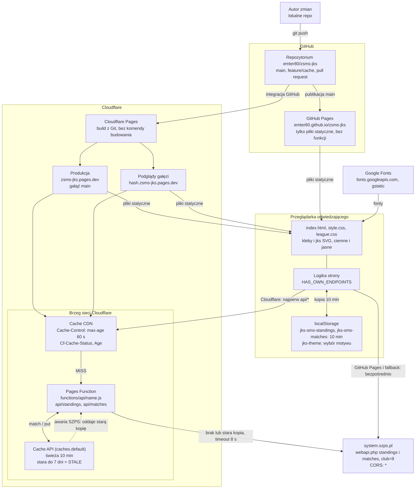
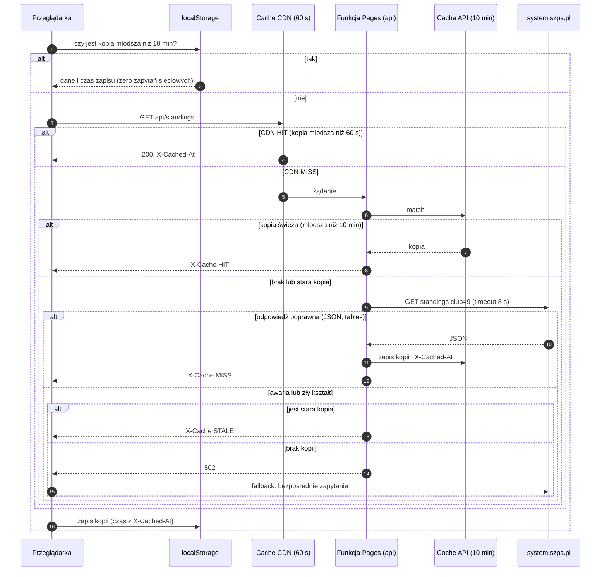

# Architektura strony JKS SMS Jastrzębie

Strona statyczna (HTML, CSS, czysty JavaScript, bez budowania) z tabelami ligowymi i wynikami
meczów. Dane pobiera na żywo z API systemu SZPS. Jest publikowana równolegle na GitHub Pages i na
Cloudflare Pages.

> **Stan wdrożenia.** Cache po stronie serwera (Cloudflare Pages Function) został scalony do `main`
> w pull requeście [#1](https://github.com/emter80/zsms-jks/pull/1). Działa na Cloudflare; na GitHub
> Pages funkcji nie ma, więc tam strona pyta API SZPS bezpośrednio i polega na cache w przeglądarce.

## 1. Architektura i warstwy cache

## 2. Przebieg jednego wejścia (Cloudflare)

## 3. Warstwy cache

| Warstwa | Czas | Kto ją trzyma | Wpływ na stronę |
|---------|------|---------------|-----------------|
| `localStorage` | 10 min | przeglądarka | brak zapytań sieciowych; czas „pobrane” bez zmian |
| Cache CDN | 60 s | brzeg Cloudflare | funkcja w ogóle się nie uruchamia |
| Cache API (funkcja) | 10 min, stara do 7 dni | brzeg Cloudflare | jedno zapytanie do SZPS na wszystkich odwiedzających |
| Bezpośrednie API | zawsze świeże | `system.szps.pl` | GitHub Pages oraz awaria funkcji |

## 4. Zasady działania

- **GitHub Pages** nie ma funkcji, więc strona od razu pyta `system.szps.pl` (reguła
  `HAS_OWN_ENDPOINTS`: host `*.github.io` oraz protokół inny niż http(s) pomijają własny endpoint),
  a jedynym cache jest `localStorage`.
- **Cloudflare**: najpierw `api/standings` i `api/matches` (własny endpoint z cache), a przy jego
  awarii (404, 502, zły kształt danych) bezpośrednie API.
- **Czas w stopce** („pobrane …”) to `X-Cached-At`, czyli moment, w którym kopia powstała, a nie chwila
  otwarcia strony. Bez tego nagłówka (bezpośrednie API) jest to bieżący czas.
- **Awaria API**: stara kopia (z funkcji lub z `localStorage`) jest pokazywana z komunikatem
  „API chwilowo niedostępne”, zamiast strony błędu.
- **Bezpieczeństwo funkcji**: klub (`club=9`) jest wpisany na sztywno, więc to nie jest otwarte proxy;
  parametry zapytania są ignorowane, nieznane nazwy dają 404, zapytanie do API ma limit 8 s.
- **Motyw** (jasny/ciemny) jest wyłącznie po stronie przeglądarki: `localStorage` (`jks-theme`),
  na telefonie domyślnie według ustawień systemu, na komputerze ciemny.

## 5. Pliki

| Plik | Rola |
|------|------|
| `index.html` | markup i cały JavaScript (menu, motyw, pobieranie danych, rozwijanie meczów) |
| `style.css`, `league.css` | style bazowe oraz tabele, karty, lista meczów, tło, motywy |
| `kleby.svg`, `kleby-light.svg` | tło: miękki dym (ciemny i jasny motyw) |
| `jks.svg`, `jks-light.svg` | obrys napisu JKS (złoty i zielony) |
| `functions/api/[name].js` | Cloudflare Pages Function: cache po stronie serwera (`/api/standings`, `/api/matches`) |
| `PROMPT.md` | pełny opis strony do odtworzenia przez AI |
| `ARCHITEKTURA.md` | ten dokument |
